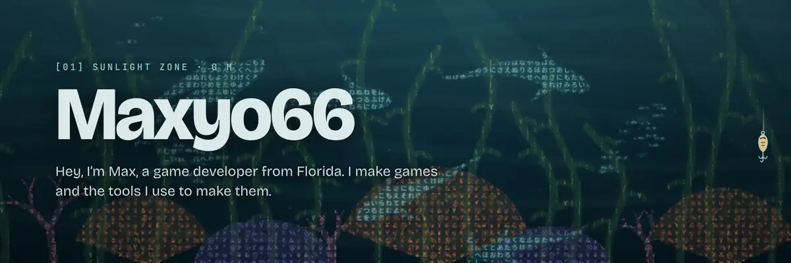

I make games and build the tools I use to make them. Every project runs like a small studio: me plus a crew of AI models, each with its own job.

- **[Abyssal](https://maxyo66.itch.io/abyssal)**: a live wallpaper that turns your Windows desktop into a slow, deep ocean. Sharks, hammerheads, mantas and jellyfish swim around on their own in a retro dither or ASCII style. The sharks above are from it.
- **[Anime Bazaar](https://github.com/Maxyo66/anime-bazaar-live)**: an anime autobattler. Pick a hero, buy gear for a board that fights on its own, and win ten fights to become champion.
- **The Living World**: a small fantasy MMO for me and my friends, where you find skills by doing things instead of picking them from a menu.
- **The Resource Hub**: 800+ tools, fonts, effects and design references I've collected and actually gone through.

**[Portfolio](https://maxyo66.github.io)** · **[itch.io](https://maxyo66.itch.io)** · **[X](https://x.com/Maxyo66)**
